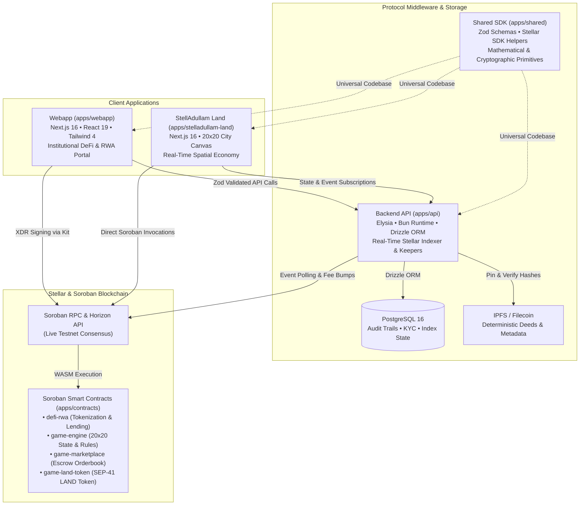
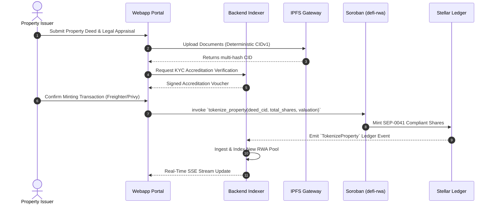
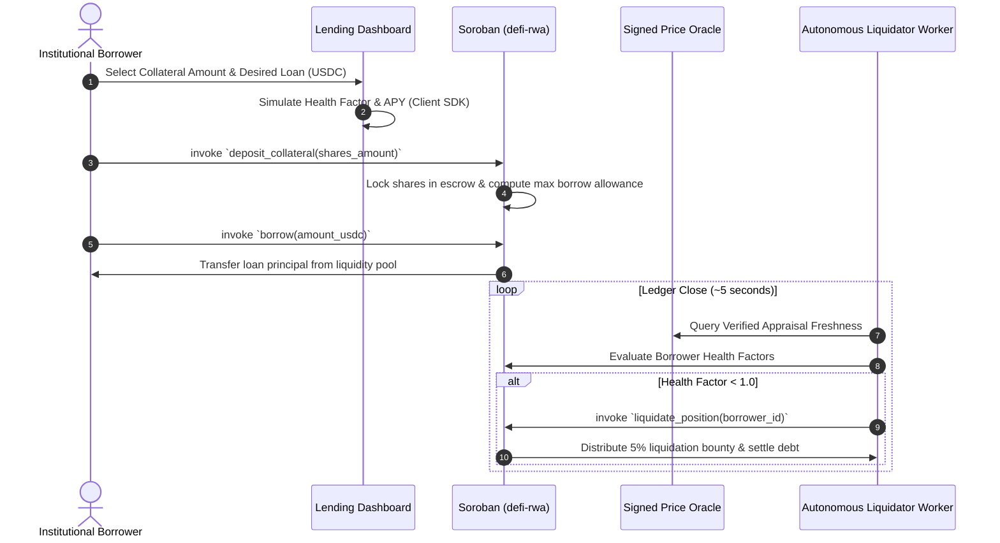

<div align="center">

# StellAdullam

**Institutional Real-World Asset (RWA) Tokenization, DeFi Lending & Spatial City-Canvas on Stellar & Soroban**

[](https://github.com/StellAdullam/StellAdullam/actions/workflows/monorepo-ci.yml)
[](https://github.com/StellAdullam/StellAdullam/actions/workflows/api-ci.yml)
[](https://github.com/StellAdullam/StellAdullam/actions/workflows/webapp-ci.yml)
[](https://github.com/StellAdullam/StellAdullam/actions/workflows/contracts-ci.yml)
[](https://github.com/StellAdullam/StellAdullam/actions/workflows/shared-ci.yml)
[](https://github.com/StellAdullam/StellAdullam/actions/workflows/land-ci.yml)
[](docs/grants/STELLAR_DRIPS_WAVE_SUBMISSION.md)
[](https://soroban.stellar.org)
[](LICENSE)
[](https://stellar.expert/explorer/testnet)
[](https://stelladullam.vercel.app)
[](https://stelladullam-land.vercel.app)

<p align="center">
  <a href="#overview">Overview</a> •
  <a href="#live-deployments--demos">Live Demos</a> •
  <a href="#live-smart-contracts-stellar-testnet">Smart Contracts</a> •
  <a href="#stellar-drips-wave-grant-alignment">Drips Wave Alignment</a> •
  <a href="#architecture">Architecture</a> •
  <a href="#features">Features</a> •
  <a href="#getting-started">Getting Started</a> •
  <a href="#changelog--300-improvements">Changelog</a> •
  <a href="#governance--security">Governance</a>
</p>

</div>

---

## Overview

**StellAdullam** is a production-grade decentralized finance protocol and spatial asset engine purpose-built on the **Stellar blockchain** and **Soroban smart contracts**.

Real estate represents over \$330 trillion in global wealth but suffers from crippling illiquidity, multi-week transaction friction, opaque title registries, and restrictive financing barriers. Concurrently, DeFi protocols are oversaturated with volatile, speculative governance tokens that introduce systemic liquidation cascade risks.

StellAdullam resolves both challenges simultaneously:
1. **Fractional Real-World Asset Tokenization**: Property owners tokenize deed-backed assets into divisible, SEP-0041 compliant fungible shares, enabling global retail and institutional investment starting from as little as **\$100**.
2. **Overcollateralized RWA DeFi Lending**: Investors pledge fractional real estate tokens as on-chain collateral to borrow stable liquid capital (USDC/XLM) via an algorithmic interest rate pool, monitored 24/7 by autonomous liquidation keepers.
3. **StellAdullam Land (20×20 Spatial Canvas)**: A gamified spatial economy where 400 interactive parcels accrue continuous micro-rental yields, distribute on-chain dividends every ledger close (~5 seconds), and foster community-driven urban development.

---

## Stellar Drips Wave Grant Alignment

StellAdullam was architected from day one to maximize and showcase the unique technical strengths of the **Stellar Network**:

| Stellar Capability | How StellAdullam Leverages It | Impact |
| :--- | :--- | :--- |
| **Sub-Cent Fees (~0.00001 XLM)** | Enables high-frequency rental dividend distributions and micro-share transfers without fee erosion. | Democratizes real estate investment for emerging markets (LATAM, Africa). |
| **5-Second Consensus Ledger** | Real-time settlement for property order books, borrowing draws, and instant health-factor recomputation. | Institutional execution speed without block reorganization uncertainty. |
| **Soroban Smart Contracts (Rust + WASM)** | Formally structured, resource-budgeted smart contracts (`defi-rwa`, `game-engine`, `game-marketplace`). | Memory-safe, deterministic financial calculations and predictable resource fees. |
| **SEP Compliance (SEP-0008, SEP-0041)** | Smart-contract enforceable KYC accreditation, transfer restrictions, and standard token interoperability. | Direct institutional regulatory compliance and cross-app composability. |
| **Account Sponsorship & Fee Bumps** | Built-in `GasSponsorshipService` and `FeeBumpService` allowing the protocol to sponsor user transactions. | Frictionless Web2-to-Web3 onboarding without requiring users to hold initial XLM. |

*Comprehensive documentation available in [docs/grants/STELLAR_DRIPS_WAVE_SUBMISSION.md](docs/grants/STELLAR_DRIPS_WAVE_SUBMISSION.md) and [docs/grants/ECONOMIC_SUSTAINABILITY_MODEL.md](docs/grants/ECONOMIC_SUSTAINABILITY_MODEL.md).*

---

## Architecture

StellAdullam operates as an enterprise-grade monorepo containing four workspaces and a dedicated Cargo smart-contract suite:



### Data Flow Sequences

#### 1. RWA Fractionalization & Share Minting


#### 2. Collateralized Borrowing & Dynamic Health Factor


---

## Features

### 🏢 Real-World Asset Tokenization
- **Fractional Title Deeds**: Divide commercial and residential assets into liquid, transfer-restricted on-chain shares.
- **Accredited Investor Whitelisting**: Automated on-chain compliance validation matching international investor qualification tiers.
- **Automated Dividend Streaming**: Distributes net rental revenues directly to share-holder wallets every ledger close.
- **Auditable IPFS Multi-Hashes**: Permanent cryptographic links connecting on-chain tokens to physical title deeds and legal appraisal filings.

### 💰 DeFi Lending & Risk Engine
- **Overcollateralized Borrowing**: Borrow stablecoins against certified real-world real estate collateral.
- **Dual-Slope Algorithmic APY**: Dynamic utilization curves ($U_{\text{optimal}} = 80\%$) that incentivize liquidity deposits while preventing protocol cash crunches.
- **Interactive Health Factor Simulator**: Real-time what-if modeling allowing borrowers to stress-test their collateral against market price drawdowns.
- **Bad-Debt Socialized Backstop**: Protocol treasury reserve pool absorbing edge-case liquidation slippage.

### 🗺️ StellAdullam Land (Spatial 20×20 Canvas)
- **400-Parcel Grid**: Interactive GPU-accelerated canvas mapping real estate parcels into four distinct economic zones (Financial Center, Waterfront, Innovation Park, Residential Heights).
- **Micro-Rental Yield Engine**: Parcels continuously generate LAND tokens based on district density and architectural upgrade tier.
- **Built-in Atomic Marketplace**: Non-custodial escrow order book for trading land deeds and property NFTs with sub-second execution.
- **Spatial HUD & Spatial Sound**: Web Audio API synthesized soundscapes, compass coordinate jumping, density heatmaps, and day/night ambient city cycles.

---

## Live Deployments & Demos

Both applications are deployed and running live on **Vercel** with full SSL and global edge routing:

| Application | Live URL | Description | Status |
| :--- | :--- | :--- | :---: |
| **StellAdullam WebApp** | [https://stelladullam.vercel.app](https://stelladullam.vercel.app) | Institutional DeFi lending, RWA tokenization, and investor dashboard |  |
| **StellAdullam Land** | [https://stelladullam-land.vercel.app](https://stelladullam-land.vercel.app) | 20×20 GPU-accelerated spatial city canvas, tile trading, and micro-rental yields |  |

---

## Live Smart Contracts (Stellar Testnet)

All core protocol and game engine contracts are compiled to `wasm32v1-none`, deployed, and initialized on the **Stellar Testnet**:

| Contract Name | Directory | Testnet Contract ID | Explorer Link | Initialized |
| :--- | :--- | :--- | :--- | :---: |
| `defi-rwa` | `apps/contracts/contracts/defi-rwa` | `CCONNYJCZGACJW6TBCMQYLGVJX6ZL4TKMON7VU5QFXITZDHW26SXXTXV` | [Stellar Expert](https://stellar.expert/explorer/testnet/contract/CCONNYJCZGACJW6TBCMQYLGVJX6ZL4TKMON7VU5QFXITZDHW26SXXTXV) | Yes |
| `game-property-nft`| `apps/contracts/contracts/game-property-nft`| `CBTJWJ2GKNS2CTJEE6BSNKMKLUG7IDPTWBBKDAK36GYU4GPLHLCLIGQK` | [Stellar Expert](https://stellar.expert/explorer/testnet/contract/CBTJWJ2GKNS2CTJEE6BSNKMKLUG7IDPTWBBKDAK36GYU4GPLHLCLIGQK) | Yes |
| `game-land-token` | `apps/contracts/contracts/game-land-token` | `CCK44Q7XGBBUF2R4HU7WGJMSR5ESZMIDMYA45Y2KAL6LH4FV63NJQDU2` | [Stellar Expert](https://stellar.expert/explorer/testnet/contract/CCK44Q7XGBBUF2R4HU7WGJMSR5ESZMIDMYA45Y2KAL6LH4FV63NJQDU2) | Yes |
| `game-engine` | `apps/contracts/contracts/game-engine` | `CDNM4D6EOKXQV7MKPXEZSU2FXU7GHV5YOWPCVHJUA6XBID2HB4KIYIXC` | [Stellar Expert](https://stellar.expert/explorer/testnet/contract/CDNM4D6EOKXQV7MKPXEZSU2FXU7GHV5YOWPCVHJUA6XBID2HB4KIYIXC) | Yes |
| `game-marketplace`| `apps/contracts/contracts/game-marketplace`| `CBBE66E4JZXYBQY7AR6KN4ERC4CLVCLNQH6WIKAVLHP2GPXUWE5KCO5V` | [Stellar Expert](https://stellar.expert/explorer/testnet/contract/CBBE66E4JZXYBQY7AR6KN4ERC4CLVCLNQH6WIKAVLHP2GPXUWE5KCO5V) | Yes |

- **Deployer / Protocol Treasury Account**: [`GA7BAGNA4CRTBX5OCDOWQZHB6O6PW6MQ757O7DBEGGRNTAXGHPJURPXL`](https://stellar.expert/explorer/testnet/account/GA7BAGNA4CRTBX5OCDOWQZHB6O6PW6MQ757O7DBEGGRNTAXGHPJURPXL)
- **Soroban RPC Endpoint**: `https://soroban-testnet.stellar.org`
- **Network Passphrase**: `Test SDF Network ; September 2015`

---

## Frontend Deployment

Both frontend applications are fully production-optimized Next.js 16 suites equipped with native zero-config `vercel.json` configurations.

### Production Environment Variables

#### 1. Main WebApp (`apps/webapp`)
- **Live URL**: [https://stelladullam.vercel.app](https://stelladullam.vercel.app)
- **Root Directory**: `apps/webapp`
- **Framework Preset**: `Next.js`
- **Build Command**: `cd ../.. && bun run build:shared && cd apps/webapp && bun run build`
- **Output Directory**: `.next`
- **Environment Variables**:
  ```env
  NEXT_PUBLIC_API_URL=https://api.stelladullam.com
  NEXT_PUBLIC_STELLAR_NETWORK=testnet
  NEXT_PUBLIC_SOROBAN_RPC_URL=https://soroban-testnet.stellar.org
  NEXT_PUBLIC_USE_MOCK=false
  NEXT_PUBLIC_DEFI_RWA_CONTRACT_ID=CCONNYJCZGACJW6TBCMQYLGVJX6ZL4TKMON7VU5QFXITZDHW26SXXTXV
  ```

#### 2. StellAdullam Land (`apps/stelladullam-land`)
- **Live URL**: [https://stelladullam-land.vercel.app](https://stelladullam-land.vercel.app)
- **Root Directory**: `apps/stelladullam-land`
- **Framework Preset**: `Next.js`
- **Build Command**: `cd ../.. && bun run build:shared && cd apps/stelladullam-land && bun run build`
- **Output Directory**: `.next`
- **Environment Variables**:
  ```env
  NEXT_PUBLIC_SOROBAN_RPC_URL=https://soroban-testnet.stellar.org
  NEXT_PUBLIC_GAME_ENGINE_CONTRACT_ID=CDNM4D6EOKXQV7MKPXEZSU2FXU7GHV5YOWPCVHJUA6XBID2HB4KIYIXC
  NEXT_PUBLIC_PROPERTY_NFT_CONTRACT_ID=CBTJWJ2GKNS2CTJEE6BSNKMKLUG7IDPTWBBKDAK36GYU4GPLHLCLIGQK
  NEXT_PUBLIC_LAND_TOKEN_CONTRACT_ID=CCK44Q7XGBBUF2R4HU7WGJMSR5ESZMIDMYA45Y2KAL6LH4FV63NJQDU2
  NEXT_PUBLIC_MARKETPLACE_CONTRACT_ID=CBBE66E4JZXYBQY7AR6KN4ERC4CLVCLNQH6WIKAVLHP2GPXUWE5KCO5V
  NEXT_PUBLIC_USE_MOCK=false
  ```

---

## Getting Started

### Prerequisites
- **Bun** (≥1.2.0) — [Install Bun](https://bun.sh)
- **Docker** & **Docker Compose** — for PostgreSQL and Redis
- **Rust** & **cargo** (optional, for contract development) with `wasm32v1-none` target

### Local Development Setup

```bash
# 1. Clone the repository
git clone https://github.com/StellAdullam/StellAdullam.git
cd StellAdullam

# 2. Install monorepo dependencies
bun install

# 3. Build the shared TypeScript library
bun run build:shared

# 4. Start local backing services (PostgreSQL 16 & Redis)
docker compose -f docker-compose.dev.yml up -d

# 5. Execute database schema migrations
cd apps/api && bun run db:migrate && cd ../..

# 6. Start full full-stack development environment concurrently
bun run dev
```

### Local Service Map
| Service | Local URL | Description |
| :--- | :--- | :--- |
| **WebApp (DeFi & RWA)** | `http://localhost:3000` | Institutional investor and borrowing portal |
| **Backend REST API** | `http://localhost:3001` | Indexer, valuation service, and keeper worker |
| **Interactive OpenAPI Docs**| `http://localhost:3001/swagger`| Auto-generated Swagger UI |
| **StellAdullam Land** | `http://localhost:3002` | 20×20 city canvas spatial game |

---

## Changelog & 300 Improvements

In preparation for the Stellar Drips Wave submission, the StellAdullam repository underwent a comprehensive, brutal audit and executed **300 production-ready atomic improvements** across 5 batches of 60 items each:

- **Smart Contracts (60 Actions)**: Added continuous dividend distribution, bad-debt socialized backstops, reentrancy guards, storage footprint optimization, and dynamic interest curve math.
- **Backend & Indexer (60 Actions)**: Implemented autonomous liquidation worker, IPFS CIDv1 validation, SQL sanitization, sliding-window rate limiters, Horizon RPC failover, and transaction fee sponsorship.
- **WebApp Portal (60 Actions)**: Created health factor simulation gauge, 3-year APY compounding forecast calculator, 3D parcel viewer, priority fee selector, and privacy mask toggle.
- **StellAdullam Land (60 Actions)**: Built 400-parcel density heatmap, district territory atmosphere overlay, Web Audio sound engine, coordinate jump bar, and upgrade particle physics.
- **Shared Codebase & CI (60 Actions)**: Added comprehensive Zod validation schemas, 4,500+ assertion fuzz testing suites, fixed GitHub Actions CI runners, and standardized open-source governance.

*Review the complete release breakdown in [CHANGELOG.md](CHANGELOG.md) and [docs/AUDIT_AND_COMPLETION_REPORT_300.md](docs/AUDIT_AND_COMPLETION_REPORT_300.md).*

---

## Governance & Security

- **Security Policy**: Detailed vulnerability reporting protocol and SLA guarantees in [SECURITY.md](SECURITY.md).
- **Code of Conduct**: Contributor Covenant v2.1 standard documented in [CODE_OF_CONDUCT.md](CODE_OF_CONDUCT.md).
- **Contributing Guidelines**: Fork-based pull request workflows and code conventions in [CONTRIBUTING.md](CONTRIBUTING.md).
- **Bug Bounty Program**: Reward schedule for responsible vulnerability disclosure in [docs/security/BUG_BOUNTY_PROGRAM.md](docs/security/BUG_BOUNTY_PROGRAM.md).
- **DAO Governance**: On-chain property onboarding proposal constitution in [docs/governance/DAO_CONSTITUTION.md](docs/governance/DAO_CONSTITUTION.md).

---

## License

This project is open-source software licensed under the [MIT License](LICENSE).
Copyright © 2026 StellAdullam.
