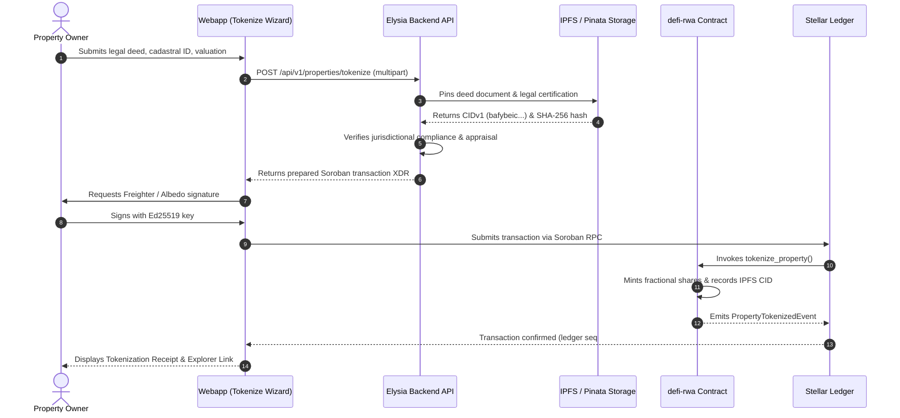
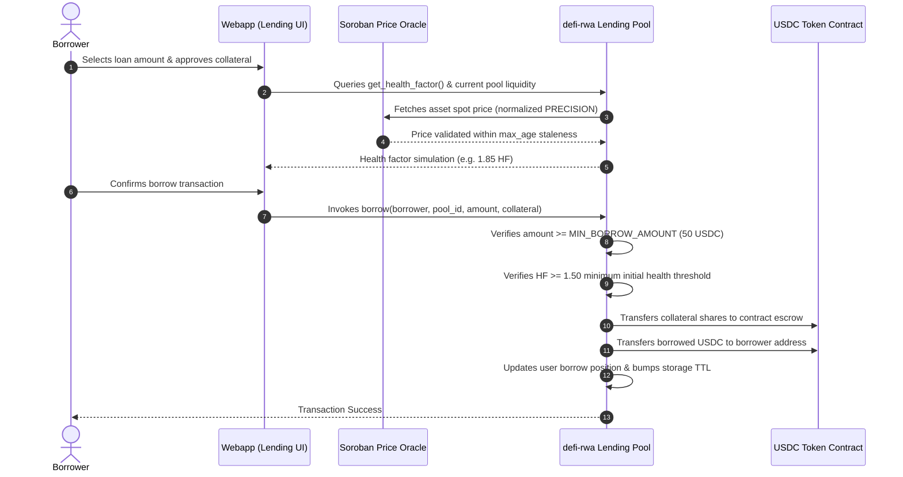
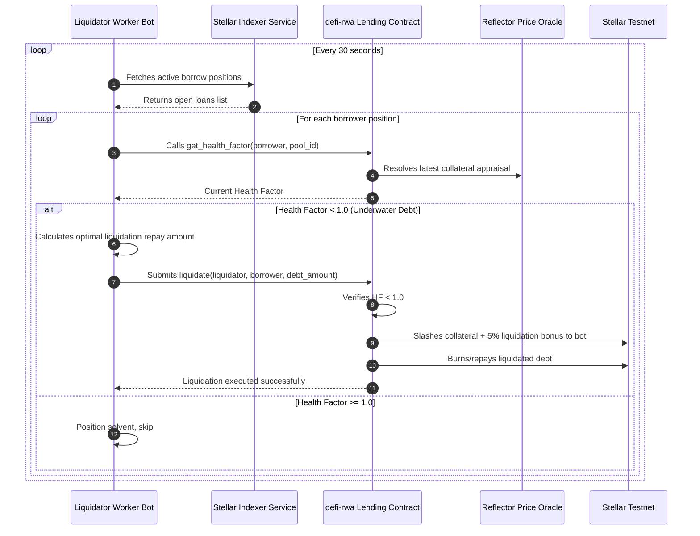
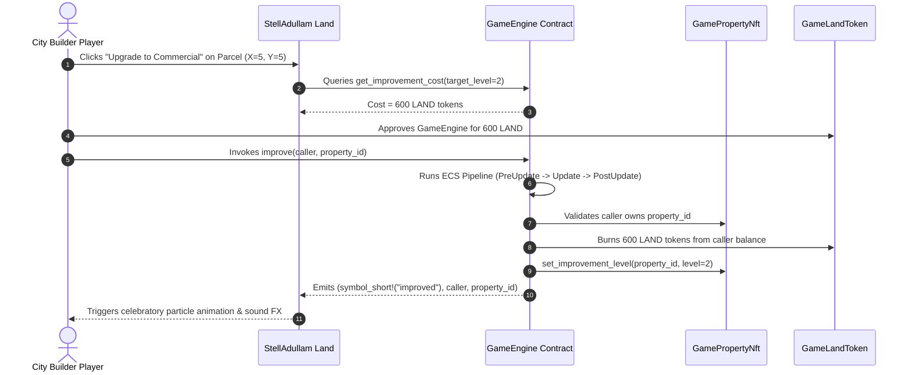

# StellAdullam End-to-End Data Flow Sequence Diagrams

This document models the critical transactional sequences of the StellAdullam platform across the frontend, backend API, IPFS storage, Price Oracle, and Soroban smart contracts.

---

## 1. Property Tokenization & Cadastral Attestation Flow

---

## 2. DeFi Collateralized Borrowing Sequence

---

## 3. Automated Liquidation Bot Workflow

---

## 4. Land Building Upgrade & Rental Harvesting

