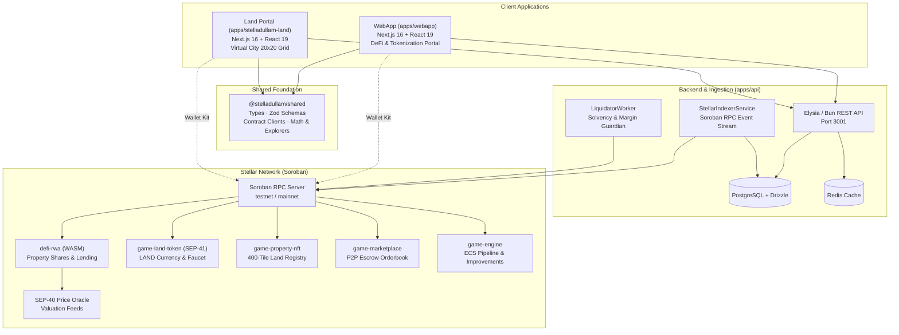
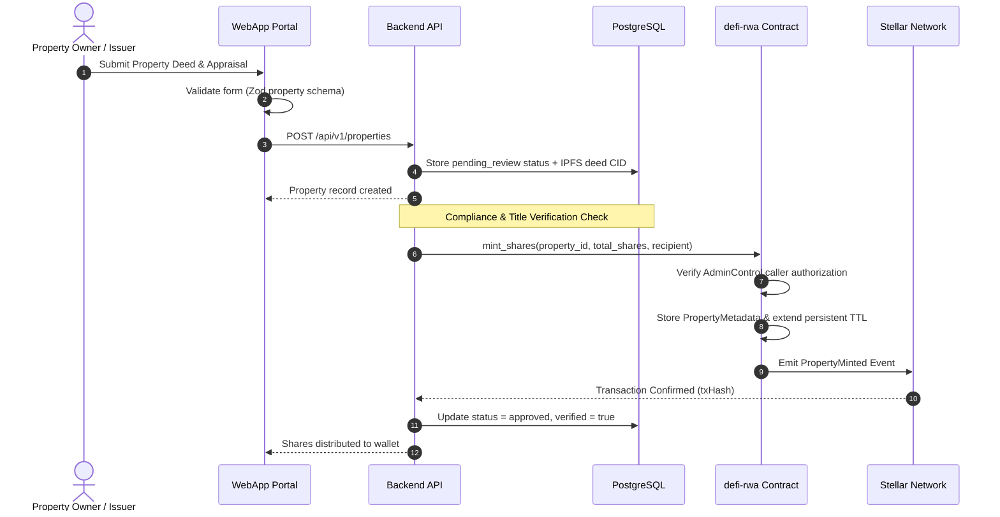
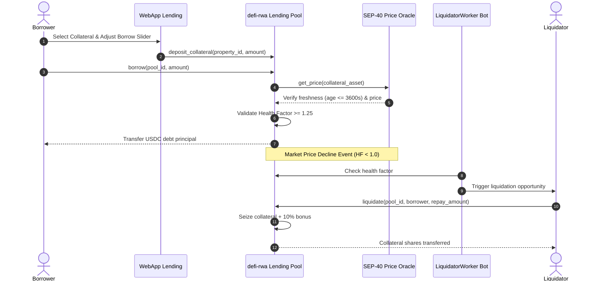
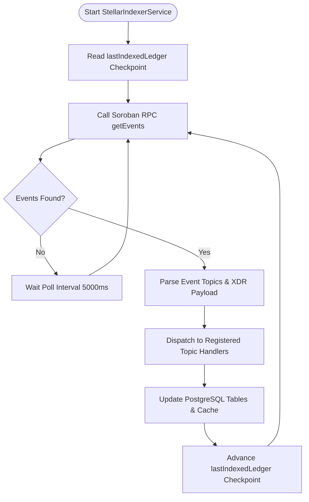

# StellAdullam — System Architecture

## Overview

StellAdullam is built as a unified Bun monorepo paired with a Soroban/Rust smart contract workspace, providing an institutional-grade platform for real estate tokenization (RWA), DeFi lending pools, and a gamified virtual economy (StellAdullam Land) on the Stellar blockchain.



---

## Workspaces Topology

| Package | Path | Stack | Role |
|---|---|---|---|
| `@stelladullam/webapp` | `apps/webapp` | Next.js 16, React 19, Tailwind 4, Zustand | Institutional DeFi platform & tokenization portal |
| `@stelladullam/land` | `apps/stelladullam-land` | Next.js 16, React 19, Tailwind 4, Web Audio | Blockchain city-building gamified economy |
| `@stelladullam/api` | `apps/api` | Elysia 1.4, Bun, Drizzle ORM, PostgreSQL, Redis | REST API, event indexer & liquidator daemon |
| `@stelladullam/shared` | `apps/shared` | TypeScript, Zod, Stellar SDK | Shared types, clients, precision math, explorers |
| _(Cargo workspace)_ | `apps/contracts` | Rust `no_std`, Soroban SDK 25.3 | 5 Soroban WASM smart contracts |

---

## Smart Contracts Architecture

```
apps/contracts/
├── defi-rwa/          ← Core platform: property fractionalization & collateralized lending
│   ├── access/        ← AdminControl, PauseControl, TimelockControl, RoleStorage
│   ├── events/        ← PropertyEvents, LendingEvents, EmergencyEvents
│   ├── lending/       ← Pool, DepositPosition, BorrowPosition, InterestModel, Oracle
│   └── storage/       ← Shares, Allowances, PropertyMetadata, Config (automated TTL)
├── game-engine/       ← ECS pipeline: improve properties & claim rental income
├── game-property-nft/ ← 400-tile NFT grid (20×20) with coordinate packing
├── game-land-token/   ← LAND SEP-41 fungible token with sybil-resistant faucet
└── game-marketplace/  ← Non-custodial escrow P2P orderbook with fee router
```

---

## Core Operational Lifecycles

### 1. Real Estate Tokenization & Share Minting



---

### 2. DeFi Lending & Automated Liquidation Protocol



---

### 3. Soroban Event Ingestion Daemon (`StellarIndexerService`)



---

## Observability & Security Standards

- **Soroban TTL Refresh**: Storage entries automatically extend instance and persistent TTL on every read/write access (`120,960` threshold, `518,400` bump).
- **Oracle Guardrails**: Enforce a maximum allowable staleness window (`3,600s`) and future timestamp drift limit (`60s`) against `env.ledger().timestamp()`.
- **Circuit Breakers**: In-memory `CircuitBreaker` pattern across shared client adapters preventing cascading RPC failures.
- **Idempotency**: All mutation APIs require `Idempotency-Key` headers to protect against accidental duplicate blockchain submissions.
