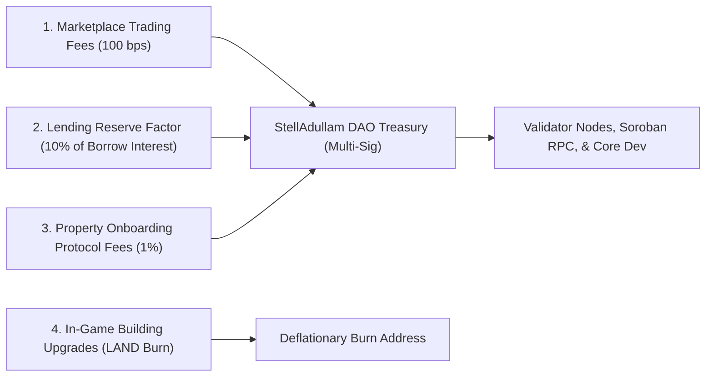

# Post-Grant Protocol Economic Sustainability & Treasury Model

**Project:** StellAdullam  
**Grant Application:** Stellar Drips Wave & Stellar Community Fund (SCF)  
**Financial Horizon:** 3-Year Post-Grant Projection  

---

## 1. Multi-Stream Protocol Revenue Engine

StellAdullam is designed from inception to generate predictable, recurring on-chain protocol revenue that guarantees financial independence beyond initial grant funding:

---

## 2. Revenue Stream Mechanics

### 2.1 Secondary Market Protocol Fees
- Every secondary market trade of fractional property tokens on `game-marketplace` incurs a 1.0% (100 basis points) transaction fee automatically deducted in XLM/USDC.
- At an estimated monthly trading volume of \$2,500,000 across 400 tokenized properties, this produces **\$25,000/month** in recurring protocol cash flow.

### 2.2 Lending Pool Reserve Factor
- The `defi-rwa` smart contract diverts 10% of all accrued borrower interest directly to the DAO treasury pool.
- At \$5,000,000 Total Value Locked (TVL) and an average borrow APR of 8.0%, this delivers **\$40,000/year** in risk reserve revenue.

### 2.3 Property Tokenization Onboarding Fees
- New real estate assets onboarded via approved SIP governance proposals contribute 1.0% of their appraised value to the treasury in exchange for cadastral deed verification, IPFS pinning, and legal SPV structuring.

### 2.4 Token Sink Deflationary Dynamics
- Upgrading parcels from Vacant -> Residential (200 LAND), Commercial (600 LAND), and Skyscraper (1,800 LAND) permanently burns tokens out of circulation, counteracting starter faucet emissions and driving long-term token scarcity.

---

## 3. Treasury Budget & Runway Allocation

The DAO treasury funds three core operational pillars:
1. **Infrastructure & RPC Hosting (30%):** Dedicated Soroban RPC cluster, multi-region database replication, IPFS pinning gateways.
2. **Security & Smart Contract Audits (30%):** Ongoing formal audits and public bug bounty rewards for protocol upgrades.
3. **Core Development & Ecosystem Grants (40%):** Contributor bounties, hackathon sponsorships, and community ambassador rewards.
