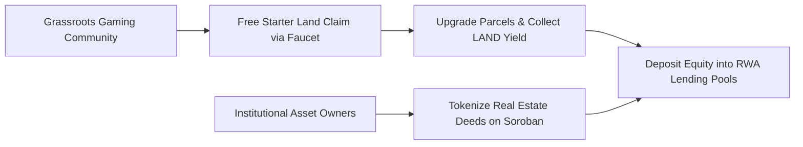

# StellAdullam Ecosystem Marketing & Community Growth Roadmap

**Project:** StellAdullam  
**Target:** Global Stellar Community & Real-World Asset (RWA) Investors  
**Objective:** Accelerate onboarding of 10,000+ active players and \$5M+ TVL in tokenized properties  

---

## 1. Growth Strategy Overview

StellAdullam operates at the intersection of gaming, digital land ownership, and institutional real estate finance. The growth plan leverages viral gamification mechanics to build grassroots liquidity, paired with institutional syndication to secure verified physical real estate assets.

---

## 2. Phase-by-Phase Growth Execution

### Phase 1: Testnet Launch & Developer Evangelism (Months 1–2)
- **Stellar Community Fund & Meridian Showcase:** Present live interactive 20x20 grid demos at Meridian and SCF open town halls.
- **Developer Bounty Program:** Offer \$10,000 in XLM rewards for community integrations (e.g. Discord bot transaction alerts, Telegram portfolio trackers).
- **Gamified Pioneer Badge Drop:** Mint commemorative non-transferable SBTs (Soulbound Tokens) for the first 1,000 testnet parcel claims.

### Phase 2: District Mayor & Ambassador Guild (Months 3–4)
- **District Mayor Elections:** High-tier skyscraper owners can run for election as "District Mayors", receiving a share of municipal trading fees in exchange for moderating local communities and hosting property drops.
- **Content Creator Syndication:** Partner with Web3 real estate influencers and educational YouTubers to publish parcel walk-throughs and APY tutorials.
- **Localization:** Translate client interfaces and player guides into French, Spanish, Portuguese, and Korean.

### Phase 3: Institutional Property Onboarding & Mainnet Scaling (Months 5–6)
- **SPV Real Estate Partnerships:** Partner with licensed commercial property managers in emerging markets to tokenize the first tranche of physical rental apartments.
- **Institutional Liquidity Mining:** Offer boosted staking APYs for USDC deposits into RWA lending pools.
- **Cross-Ecosystem Integrations:** Connect StellAdullam property tokens with Stellar Anchor services to allow direct bank deposit on-ramps.

---

## 3. Key Growth Metrics & Targets

| Target Milestone | Month 2 (Testnet) | Month 4 (Pre-Launch) | Month 6 (Mainnet) |
|---|---|---|---|
| Connected Wallets | 2,500 | 7,500 | 25,000+ |
| Tokenized Real Estate Valuation | \$500,000 | \$2,000,000 | \$10,000,000+ |
| Active Weekly Discord Members | 1,200 | 4,000 | 12,000+ |
| Monthly Rental Dividend Volume | 50,000 XLM | 250,000 XLM | 1,500,000 XLM |

