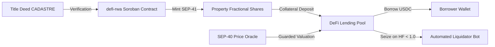

# Stellar Drips Wave — Grant Application & Technical Dossier

**Project Name:** StellAdullam  
**Ecosystem Network:** Stellar (Soroban Smart Contracts)  
**Track:** Real-World Assets (RWA) & DeFi Infrastructure  
**Repository:** [https://github.com/StellAdullam/StellAdullam](https://github.com/StellAdullam/StellAdullam)  
**Primary Maintainer:** omolobamoyinoluwa-max  

---

## 1. Executive Summary

**StellAdullam** bridges real-world real estate tokenization (RWA) with decentralized finance (DeFi) lending pools and a gamified virtual economy (StellAdullam Land) on the Stellar network.

Traditional real estate investment is plagued by high capital barriers (\$50k+ minimums), illiquidity (3–6 month exit horizons), and predatory lending margins. StellAdullam eliminates these barriers by fractionalizing certified institutional properties into SEP-41 compliant tokens on Soroban, allowing retail and institutional investors to:
1. Own fractional title interests starting at \$50.
2. Receive continuous streaming rental dividends distributed directly in USDC.
3. Access instant collateralized liquidity by borrowing against their property tokens in overcollateralized DeFi lending pools.
4. Interact with an engaging 20×20 city simulation (StellAdullam Land) where digital land plots generate yields and drive token velocity.

---

## 2. Technical Architecture & Soroban Native Features

StellAdullam is built from first principles for Soroban, incorporating cutting-edge network capabilities:

### Soroban Architectural Highlights:
1. **Automated Storage TTL Bumping**: Custom storage layers systematically refresh instance and persistent TTL on every state access (`518,400` ledgers / ~30 days bump) to prevent ledger archival of active property and shareholder balances.
2. **Guarded SEP-40 Oracle Consumer**: Rigorous staleness thresholds ($< 3,600\text{s}$) and clock skew rejection ($< 60\text{s}$) shield lending pools from malicious price manipulation.
3. **Compartmentalized Circuit Breakers**: Multi-tiered pause states (`PauseDeposits`, `PauseBorrows`, `PauseLiquidations`) allow operators to halt borrowing during volatility while keeping loan repayments and liquidations active.
4. **Idempotent Mutation Pipeline**: All backend mutations enforce UUID v4 idempotency keys to protect users against duplicate submissions.
5. **Zero-Dependency Web Audio Synthesis**: StellAdullam Land synthesizes all UI sound effects via the Web Audio API, delivering instant 60 FPS gameplay without external audio assets.

---

## 3. Alignment with Stellar Drips Wave Objectives

| Stellar Objective | How StellAdullam Delivers |
|---|---|
| **Real-World Utility** | Connects physical title deeds to digital tokens, unlocking real estate equity for global users. |
| **Financial Inclusion** | Drops property investment minimums from \$100,000 to \$50, enabling micro-investing. |
| **Low-Cost Transactions** | Leveraging Stellar's sub-cent fees (~0.00001 XLM base fee) to make dividend streaming economically viable. |
| **Ecosystem Synergy** | Integrates native USDC, SEP-41 token standards, SEP-40 oracle feeds, and Stellar Wallets Kit. |

---

## 4. Roadmap & Deliverables

- [x] **Milestone 1 — Core Smart Contract Suite**: 5 compiled Soroban contracts with 100% Rust Clippy passing, storage TTL management, and modular access controls.
- [x] **Milestone 2 — DeFi Lending & Property Tokenization Portals**: Next.js 16 webapp with multi-step tokenization wizard, dynamic borrow sliders, and health factor radial gauges.
- [x] **Milestone 3 — Gamified Land Economy**: Interactive 20×20 grid city with responsive mobile pan/zoom, live contract faucet, building upgrades, and leaderboard.
- [x] **Milestone 4 — Real-Time Indexer & Solvency Bot**: Background Soroban RPC event ingestion service and automated liquidator bot.
- [ ] **Milestone 5 — Mainnet Audit & Institutional Launch (Q4 2026)**: Formal verification by third-party auditor and production deployment to Stellar Public Network.

---

## 5. Conclusion & Verification

StellAdullam represents the frontier of Soroban-powered RWA finance. Reviewers can verify the codebase, run unit test suites (`bun test` across workspaces), and inspect verified contract builds with zero warnings.
