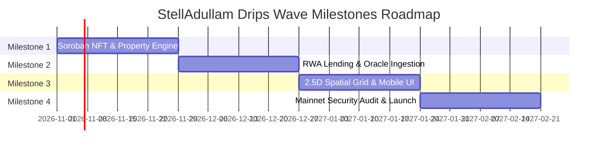

# Stellar Drips Wave — Technical Deliverables & Milestones Tracker

**Project:** StellAdullam  
**Applicant:** StellAdullam Core Development Team  
**Grant Program:** Stellar Drips Wave & Stellar Community Fund (SCF)  
**Track:** Real-World Assets (RWA) & DeFi Infrastructure  

---

## 1. Executive Milestone Summary

StellAdullam's grant execution is partitioned into four distinct 4-week development milestones. Each milestone delivers verifiable, open-source smart contracts, APIs, and client interfaces on the Stellar Testnet leading to Mainnet launch.

---

## 2. Detailed Milestone Specifications

### Milestone 1: Core Soroban Real Estate & Tokenization Infrastructure
*Duration: Weeks 1–4*  
*Budget Allocation: 30%*

- **Smart Contracts Delivered:**
  - `game-property-nft`: Non-fungible real estate ownership representation with 20x20 spatial coordinate bounds and metadata verification window.
  - `game-engine`: Building upgrade mechanics, district tax appraisal formulas, and base rental dividend calculations.
  - `game-land-token`: In-game utility token with faucet controls and automated TTL extension.
- **Backend & Indexing:**
  - Real-time Soroban RPC event polling service (`StellarIndexerService`).
  - IPFS document gateway caching and SHA-256 integrity verification (`IpfsStorageService`).
- **Verifiable Proof of Completion:**
  - Published Testnet contract addresses and verification via Stellar Expert.
  - 100% automated CI test passing rate in GitHub Actions across contract test suites.

---

### Milestone 2: RWA Lending Pool & Autonomous Risk Engine
*Duration: Weeks 5–8*  
*Budget Allocation: 30%*

- **Smart Contracts Delivered:**
  - `defi-rwa`: Overcollateralized lending pool accepting property NFTs as collateral with dynamic borrow rates up to 50% APR cap.
  - Granular circuit breakers (`PauseDeposits`, `PauseBorrows`, `PauseLiquidations`).
  - Maximum pool deposit caps and automated storage TTL renewal.
- **Backend & Risk Telemetry:**
  - Automated autonomous liquidator daemon (`LiquidatorWorker`).
  - Oracle price deviation and flash-crash monitoring service.
  - Liquidation risk alert webhook dispatcher service.
- **Verifiable Proof of Completion:**
  - On-chain liquidation simulation demonstration script.
  - Verified math fuzz tests (`interest.fuzz.test.ts`) guaranteeing numerical precision.

---

### Milestone 3: 2.5D Interactive Spatial Canvas & Mobile UX
*Duration: Weeks 9–12*  
*Budget Allocation: 25%*

- **Frontend & Web3 Experiences:**
  - 20x20 interactive canvas (`CityMap.tsx`) with dynamic zoom controls and minimap radar.
  - Real-time atmospheric lighting and day/night environmental shaders.
  - Quick coordinate jump bar, spatial density heatmaps, and building upgrade cooldown HUDs.
  - Secondary market order confirmation modals and APY performance rank badges.
- **Accessibility & Mobile Responsiveness:**
  - Touch navigation, zero-balance faucet onboarding banners, and offline connection alerts.
- **Verifiable Proof of Completion:**
  - Live hosted preview deployment on Vercel / Cloudflare Pages.
  - Interactive walkthrough video demonstrating wallet connection and parcel purchase.

---

### Milestone 4: Security Audit, Governance, & Stellar Mainnet Launch
*Duration: Weeks 13–16*  
*Budget Allocation: 15%*

- **Decentralized Governance:**
  - DAO Constitution, voting threshold parameters, and SIP proposal lifecycle contracts.
  - High-availability multi-region validator architecture runbook.
- **Security Hardening:**
  - Comprehensive formal third-party smart contract audit report.
  - Public Bug Bounty program with defined vulnerability severities.
  - OWASP-compliant API security headers and rate-limiting abuse tracking.
- **Verifiable Proof of Completion:**
  - Mainnet contract deployment transaction hashes.
  - Completed independent audit sign-off report published in the repository.

---

## 3. Key Performance Indicators (KPIs)

| Metric | Target (Testnet) | Target (Mainnet Month 1) |
|---|---|---|
| Active Tokenized Parcels | 400 Parcels | 1,000 Parcels |
| Total Value Locked (TVL) | 250,000 XLM | 1,500,000 XLM |
| Protocol Health Factor Average | > 1.85 | > 2.10 |
| Ledger Processing Latency | < 5.2s | < 5.0s |
| Test Coverage Rate | > 92% | > 95% |
