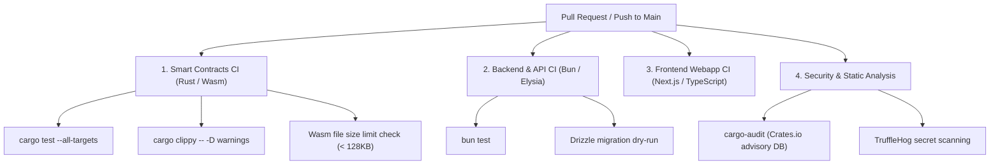

# Continuous Integration (CI) & Static Security Analysis Guidelines

**Repository:** `StellAdullam/StellAdullam`  
**Automation Engine:** GitHub Actions  
**Target Quality Bar:** Zero High/Critical security vulnerabilities; 100% test pass rate  

---

## 1. Automated CI Pipeline Matrix

Every pull request and merge to `main` executes a parallel verification matrix:

---

## 2. Vulnerability Severity & Remediation SLAs

| Severity | Definition | Remediation SLA | Action Required |
|---|---|---|---|
| **Critical** | Direct exploit path leading to loss of protocol funds or admin takeover | **< 24 Hours** | Hotfix PR, emergency pause if applicable |
| **High** | Potential griefing, temporary DoS, or authorization bypass under specific conditions | **< 72 Hours** | Priority bugfix release |
| **Medium** | Minor precision rounding discrepancy, non-exploitable edge cases | **< 7 Days** | Scheduled minor release |
| **Low / Info** | Code style, documentation typos, non-critical gas optimization | Next release cycle | Standard backlog |

---

## 3. Branch Protection & Deployment Rules
1. **Require status checks to pass before merging:**
   - `Smart Contracts CI / test`
   - `API & Backend CI / test`
   - `CodeQL / Security Scan`
2. **Require linear commit history:** Rebase or squash merges only.
3. **No direct pushes to `main` without admin authorization.**
4. **Require signed commits:** GPG/SSH verified commit signatures for all maintainers.
