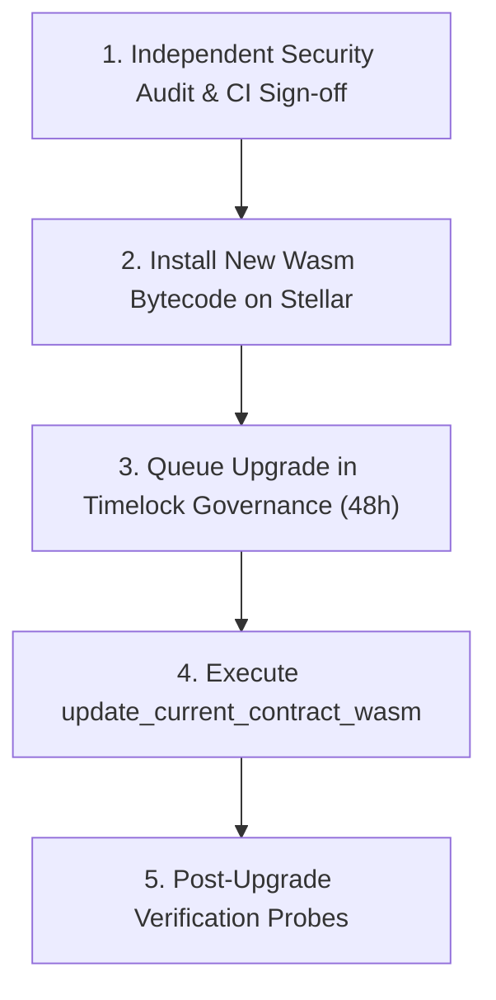

# Soroban Smart Contract Upgrade & State Migration Runbook

**Protocol:** StellAdullam Soroban Core Contracts  
**Target Contracts:** `defi-rwa`, `game-engine`, `game-marketplace`, `game-property-nft`  
**Mechanism:** Soroban In-Place Wasm Upgrade via `update_current_contract_wasm`  

---

## 1. Upgrade Lifecycle & Governance

All smart contract upgrades within the StellAdullam protocol must follow a strict three-phase procedure to ensure security, state integrity, and community transparency:



---

## 2. Step-by-Step Upgrade Procedure

### Step 1: Compile & Optimize Wasm Bytecode
Build optimized production Wasm binaries:
```bash
cargo build --target wasm32-unknown-unknown --release
stellar contract optimize --wasm target/wasm32-unknown-unknown/release/defi_rwa.wasm
```

### Step 2: Install Wasm on Stellar Network
Upload the optimized Wasm blob to the network without instantiating it:
```bash
NEW_WASM_HASH=$(stellar contract install \
  --wasm target/wasm32-unknown-unknown/release/defi_rwa.optimized.wasm \
  --source-account "${ADMIN_SECRET}" \
  --network testnet)

echo "Installed Wasm Hash: ${NEW_WASM_HASH}"
```

### Step 3: Schedule Governance Timelock Execution
Submit a governance proposal to queue the contract upgrade with a 48-hour delay:
```bash
stellar contract invoke \
  --id "${DEFI_RWA_CONTRACT_ID}" \
  --source-account "${ADMIN_SECRET}" \
  --network testnet \
  -- schedule_upgrade \
  --new_wasm_hash "${NEW_WASM_HASH}"
```

### Step 4: Execute In-Place Upgrade
Once the 48-hour timelock period has elapsed, trigger the upgrade execution:
```bash
stellar contract invoke \
  --id "${DEFI_RWA_CONTRACT_ID}" \
  --source-account "${ADMIN_SECRET}" \
  --network testnet \
  -- upgrade \
  --new_wasm_hash "${NEW_WASM_HASH}"
```

---

## 3. Storage Schema Compatibility Guidelines

Soroban contracts maintain state across Wasm upgrades. To prevent data corruption:
1. **Never change existing enum integer discriminants:** Adding new enum variants must always append to the end.
2. **Never change serialized struct field ordering:** Adding new fields to `contracttype` structs must either use optional wrappers (`Option<T>`) or migrate into new storage keys.
3. **Storage TTL Maintenance:** Verify that instance and persistent storage TTLs are extended (`bump_instance` / `bump_persistent`) during migration to prevent state eviction.

---

## 4. Post-Upgrade Health Verification Script

Run the automated post-upgrade check suite:
```bash
./scripts/verify-contracts.sh
```
Verify that all query endpoints (`get_pool_list`, `get_health_factor`, `get_listing_count`) respond normally and maintain historical ledger balances.

