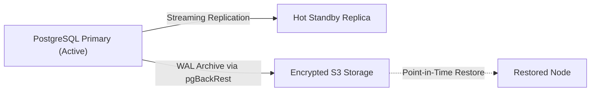

# PostgreSQL Backup, Replication, & Point-in-Time Recovery (PITR) Runbook

**Service:** StellAdullam Indexing & Metadata Datastore  
**Database Engine:** PostgreSQL 16+  
**Target RPO (Recovery Point Objective):** <= 5 minutes  
**Target RTO (Recovery Time Objective):** <= 15 minutes  

---

## 1. Architecture Overview

StellAdullam's off-chain indexing services (capturing Soroban contract events, parcel deeds, and user telemetry) utilize a primary PostgreSQL node with continuous Write-Ahead Log (WAL) archiving to an encrypted, air-gapped S3 bucket, complemented by a hot-standby streaming replica.



---

## 2. Automated Backup Strategy

### 2.1 Daily Full Snapshots
Automated daily snapshots are executed at 02:00 UTC using `pg_dump` with gzip compression:
```bash
#!/usr/bin/env bash
set -euo pipefail

BACKUP_DATE=$(date +%Y%m%d_%H%M%S)
BACKUP_FILE="/backups/stelladullam_db_${BACKUP_DATE}.sql.gz"

pg_dump -h "${DB_HOST}" -U "${DB_USER}" -d "${DB_NAME}" --format=custom | gzip > "${BACKUP_FILE}"
aws s3 cp "${BACKUP_FILE}" "s3://${BACKUP_BUCKET}/daily/${BACKUP_FILE##*/}" --sse aws:kms
rm -f "${BACKUP_FILE}"
```

### 2.2 Continuous WAL Archiving (`postgresql.conf`)
Ensure continuous WAL archiving is enabled on the primary cluster:
```ini
wal_level = replica
archive_mode = on
archive_command = 'pgbackrest --stanza=stelladullam archive-push %p'
archive_timeout = 300
```

---

## 3. Step-by-Step Point-in-Time Recovery (PITR)

In the event of catastrophic data corruption or accidental drop table events, follow this exact procedure to restore the database to an exact minute prior to the incident:

### Step 1: Stop Application Traffic
Pause off-chain API indexers and workers:
```bash
kubectl scale deployment stelladullam-api --replicas=0
kubectl scale deployment stelladullam-indexer --replicas=0
```

### Step 2: Provision Fresh Restore Volume & Configure Recovery Target
Stop the PostgreSQL service on the designated restore target node:
```bash
sudo systemctl stop postgresql
sudo rm -rf /var/lib/postgresql/16/main/*
```

Restore the base backup:
```bash
pgbackrest --stanza=stelladullam --delta restore
```

### Step 3: Configure Recovery Signal & Timestamp
Create `recovery.signal` in the PostgreSQL data directory:
```bash
touch /var/lib/postgresql/16/main/recovery.signal
```

Append target recovery point in `postgresql.auto.conf`:
```ini
restore_command = 'pgbackrest --stanza=stelladullam archive-get %f "%p"'
recovery_target_time = '2026-10-30 12:45:00 UTC'
recovery_target_action = 'promote'
```

### Step 4: Start Recovery Process
Start PostgreSQL and monitor recovery progress in logs:
```bash
sudo systemctl start postgresql
sudo tail -f /var/log/postgresql/postgresql-16-main.log
```
Look for:
`LOG: archive recovery complete`  
`LOG: database system was not properly shut down; automatic recovery in progress`  
`LOG: recovery stopping at restore point, time: ...`

---

## 4. Post-Recovery Verification

Run consistency verification on ledger checkpoint tables:
```sql
-- Verify latest indexed ledger height aligns with target timestamp
SELECT max(ledger_sequence), max(indexed_at) FROM stellar_indexer_checkpoints;

-- Verify integrity of parcel ownership records
SELECT count(*) FROM property_deeds WHERE owner_address IS NOT NULL;
```

Once confirmed:
```bash
kubectl scale deployment stelladullam-api --replicas=3
kubectl scale deployment stelladullam-indexer --replicas=1
```

