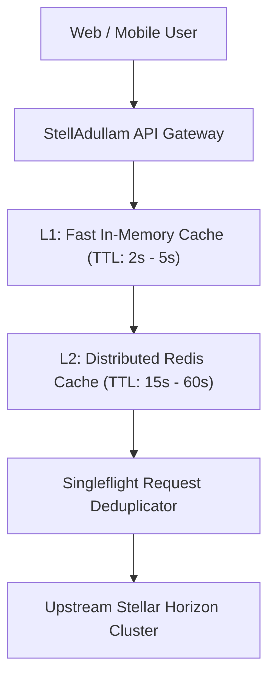

# Stellar Horizon Rate Limiting & Multi-Tier Caching Runbook

**Service:** StellAdullam Off-Chain Horizon Gateway  
**Upstream Target:** SDF Public Horizon & Dedicated Enterprise Endpoints  
**SLA Goal:** Zero HTTP 429 (Too Many Requests) errors to end-users  

---

## 1. Rate Limiting Architecture

Public Horizon instances enforce strict IP-based rate limiting (typically 3,600 requests/hour or dynamic token buckets). StellAdullam implements a multi-tier proxy caching strategy:

---

## 2. Caching Policies by Endpoint

| Horizon Resource | L1 Memory TTL | L2 Redis TTL | Invalidation Strategy |
|---|---|---|---|
| `/ledgers/latest` | 2 seconds | 5 seconds | Auto-expires on ledger close |
| `/accounts/{id}` | 5 seconds | 15 seconds | Invalided on tx submission |
| `/order_book` | 3 seconds | 10 seconds | Auto-expires |
| `/fee_stats` | 10 seconds | 30 seconds | Polled periodically |
| `/transactions/{hash}` | 1 hour | 24 hours | Immutable once confirmed |

---

## 3. Singleflight Deduplication

During flash crowds (e.g. newly minted property parcel drops), hundreds of concurrent client browsers query identical resource paths (such as the property token contract balance or orderbook depth).

StellAdullam's gateway wraps all outgoing Horizon calls with a singleflight mutex:
- The first arriving request triggers the upstream HTTP fetch.
- All subsequent identical requests within a 2-second window await the resolution of the first promise rather than issuing separate HTTP calls to Horizon.
- Reduces upstream request volume by up to 95%.

---

## 4. Automatic Backoff & Retry Handling

When an upstream 429 response is detected:
1. Extract the `Retry-After` header value (default to 2000ms if absent).
2. Mark the corresponding provider degraded in `RPC_FAILOVER_STRATEGY`.
3. Shift active routing to the secondary dedicated enterprise node.
4. Retry the request with randomized exponential jitter:
   $$\text{Backoff} = \min(\text{Retry-After} \times 2^{\text{attempt}} + \text{jitter}, 8000\text{ms})$$
